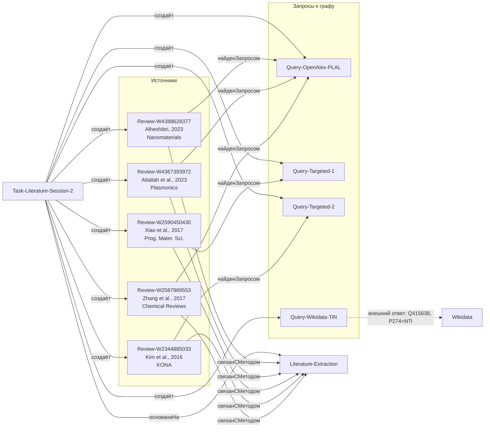

# Граф литературы: сессия 2

[порождено] Продолжение графа проекта; старый `graph_view.md` не изменялся. Схема отражает только новые заметки этой сессии и разрешённые связи онтологии.

## Соответствие заметкам

- Источники: `notes/Review-W2587989553.md`, `notes/Review-W2344885033.md`, `notes/Review-W2590450430.md`, `notes/Review-W4367393972.md`, `notes/Review-W4388628377.md`.
- Запросы: `notes/Query-OpenAlex-PLAL.md`, `notes/Query-Targeted-1.md`, `notes/Query-Targeted-2.md`, `notes/Query-Wikidata-TiN.md`.
- Задача: `tasks/Task-Literature-Session-2.md`.
- Метод: `notes/Literature-Extraction.md` (существующая заметка).

## Оговорки

- `Query-Wikidata-TiN` не порождает новый источник в `reviews.json`; это отдельная проверка сущности TiN.
- Фактический тип графа OpenAlex у W2344885033 и W2590450430 — `article`, хотя по содержанию это обзоры. На схеме это не скрывается.
- Проверка студентом для всех новых заметок: pending.
