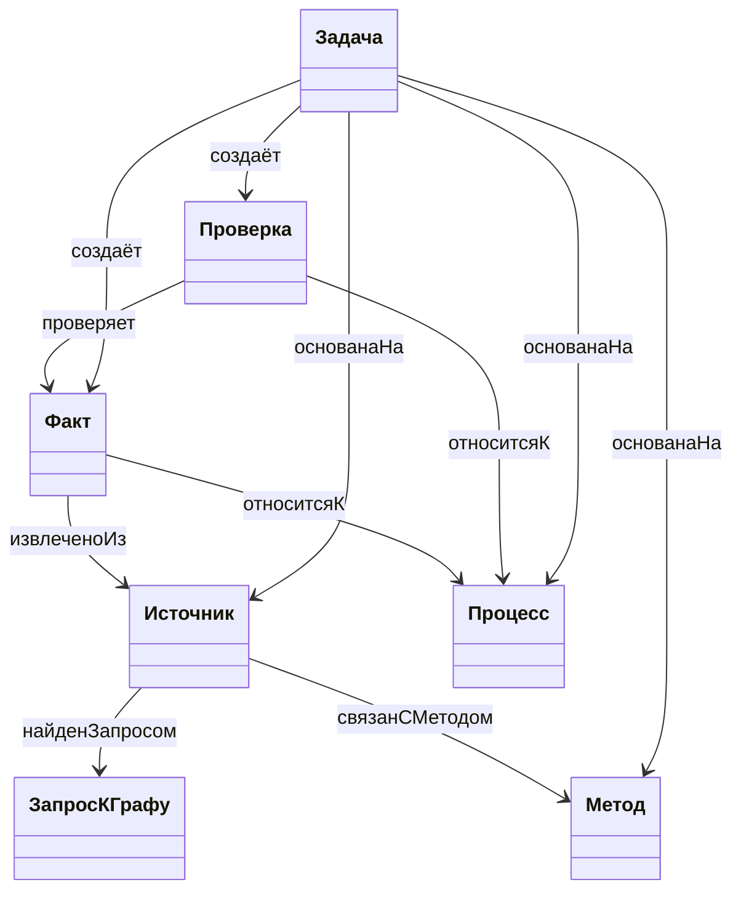
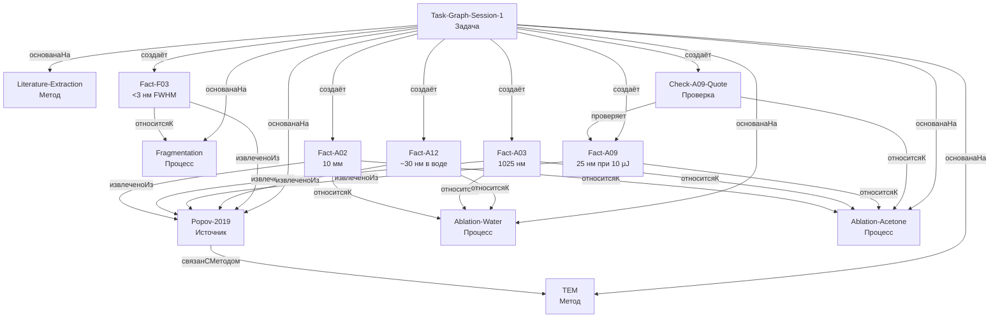

# Граф проекта TiN

[порождено] Схема отражает только записи этой сессии. Она не добавляет научных выводов и не заменяет проверку `checks/check.py`.

## Схема классов

## Экземпляры и связи

## Пояснения

- Классы — отдельные заметки в `ontology/`; объекты — в `notes/` и `tasks/`. Одна и та же заметка не может быть одновременно классом и объектом.
- `Popov-2019` — единственный первоисточник. Метаданные и PDF: [[paper/source.json]], [[paper/article.pdf]].
- Абляция в воде, абляция в ацетоне и последующая фрагментация — три разных процесса. Факты привязаны к среде и этапу; общие параметры с. 8 не выдаются за условия каждого опыта.
- Пять фактов взяты из [[results/conditions.csv]]: [[Fact-A02]], [[Fact-A03]], [[Fact-A09]], [[Fact-A12]], [[Fact-F03]]. Их цитаты и страницы указаны в заметках.
- `Check-A09-Quote` ссылается на конкретный факт [[Fact-A09]] и на команду `python checks/check.py extraction`; запуск дал `PASS`, код 0.
- `Literature-Extraction` описывает метод извлечения литературы. Объект `ЗапросКГрафу` не создавался: подтверждённого внешнего запроса в этой сессии не было.
- Расхождения μJ/mJ и 4/~5 нм не разрешены и не переписаны; они перечислены в [[results/conflicts.md]].
- Статус задачи — `ожидает проверки`, не `принята`. Критерий — код проверки графа и число объектов, а не научное одобрение.

## Файлы

- [[results/conditions.csv]]
- [[results/conflicts.md]]
- [[paper/pages/page_02.txt]]
- [[paper/pages/page_03.txt]]
- [[paper/pages/page_08.txt]]
